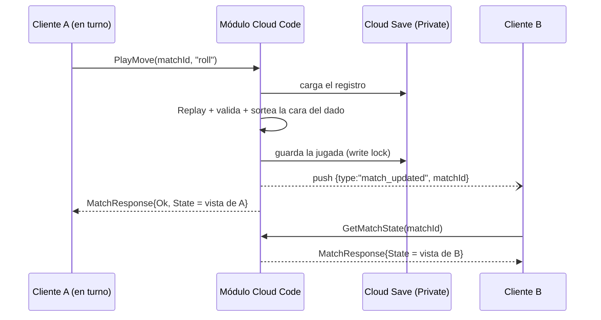

# Protocolo de Microbe_OPS (patrón TTTXO)

Partida 1 contra 1 por turnos. El **módulo de Unity Cloud Code** (`Server/MicrobeOps.Module`) es la **autoridad**: valida cada jugada con las mismas reglas que el cliente compila (`Assets/Scripts/MicrobeOps/Core`), sortea el dado y guarda la partida. El cliente solo envía *intenciones* y dibuja la *vista* que le devuelve el servidor.

```
Cliente A ──CreateMatch(handoffId)──▶ Cloud Code ──▶ Cloud Save (registro de jugadas, PRIVATE)
Cliente A ──PlayMove(matchId, kind…)──▶ Cloud Code: valida jugador + turno + fase + reglas → guarda
                                         └─ push "match_updated" {type, matchId} ──▶ Cliente B
Cliente B ──GetMatchState(matchId)──▶ Cloud Code ──▶ MI vista (sin los organismos de A)
```

## Endpoints (cliente → servidor)

Tipos en `Core/Protocol.cs`, compartidos por cliente y servidor. `GameProtocol.Version` (hoy `1`) se sube **solo** cuando cambia el contrato de un endpoint; el cliente la compara con `GetGameConfig` al conectar.

| Endpoint | Parámetros | Qué hace |
|---|---|---|
| `GetGameConfig` | – | Versión del protocolo, tamaño del tablero, segundos por turno y periodo de sondeo. Pendiente: leerla de Remote Config. |
| `CreateMatch` | `handoffId` | Idempotente. El `matchId` sale del hash del `handoffId`, así los dos jugadores llegan al mismo registro. El primero crea una partida *esperando*; el segundo la completa, se ordenan los `playerId` (el primero son los Glóbulos Blancos y empieza), se guarda la **semilla secreta** de colocación y arranca. Un tercero recibe `RoomFull`. Devuelve también la partida en curso si el jugador se reconecta. |
| `PlayMove` | `matchId`, `kind`, `x`, `y`, `organismId`, `rotation` | `kind` = `roll` \| `shoot` \| `relocate` \| `leave`. **No existe parámetro para la cara del dado.** Devuelve `MatchResponse { Ok, Code, Message, State }`; si se rechaza, `State` trae el estado actual para resincronizar. |
| `GetMatchState` | `matchId` | Mi vista. También resuelve con el reloj del servidor los turnos vencidos y el abandono. |
| `SweepAbandonedMatches` | `maxMatches?` | Lo dispara un trigger programado (`Deploy/*.tr`, `*.sched`, cada 5 min). Cierra partidas que nadie consulta. |

### Qué valida `PlayMove` (en este orden)

1. Carga el registro de Cloud Save (`MatchNotFound` si no existe).
2. Comprueba que `context.PlayerId` —nunca un id enviado por el cliente— es jugador de la partida (`NotInMatch`).
3. **Reproduce** el registro con un motor nuevo (`MatchEngine.Replay`) y registra como jugadas `timeout` los turnos vencidos según el reloj del servidor.
4. Si la partida terminó → `MatchFinished`. Si no es su turno o su plazo venció → `NotYourTurn`.
5. Aplica la jugada con el motor de Core: `AlreadyRolled`, `WrongPhase`, `OutOfBounds`, `AlreadyShot`, `UnknownOrganism`, `InvalidRelocation`, `UnknownMove`. Un `timeout` enviado por un cliente se rechaza: solo lo genera el servidor.
6. Si el dado se tira, **el servidor sortea la cara** (`RandomNumberGenerator`) y la guarda en la jugada.
7. Guarda con *write lock*; si el rival escribió a la vez (`409`), reintenta con datos frescos hasta 5 veces (`Busy` después).
8. Envía el push al rival (si falla, la jugada **no** falla) y devuelve **la vista de quien llamó**.

## Estado: lista de jugadas con replay

El registro (`MatchRecord`) guarda `PlayerIds`, `Settings`, `StartedAtMs`, `PlacementSeed` y `Moves[]`; **no** guarda el tablero. Cada llamada lo reproduce:

* **Colocación**: sale de `SeededRandom(PlacementSeed)` (generador propio, no depende de la versión de .NET).
* **Dado**: la jugada `roll` lleva su `Face` (1–10). El azar no entra al motor: por eso el replay es determinista.
* **Reloj**: cada jugada lleva su `AtMs`. Un `timeout` se registra en el instante *exacto* del plazo (no "ahora"), de modo que el siguiente turno empieza donde terminó el anterior y el resultado no depende de cuándo se consultó.

Guardado en **Cloud Save Custom Data, clase de acceso PRIVATE** (`customId = matchId`, clave `record`; índice en `customId = match-index`). Ver `CloudSaveMatchStore.cs`; hay una prueba que impide usar las llamadas de clase Default.

## Vista por jugador (información oculta)

`MatchStateDto` contiene: mi tablero completo, **solo** las casillas ya disparadas del rival (`OpponentShots`, `OpponentSunk`) y el historial público `Events`. No contiene la semilla ni las posiciones del rival; `OpponentBoard` solo viene cuando la partida terminó. Las jugadas `relocate` aparecen en `Events` **sin coordenadas**: el rival sabe que ocurrió, no dónde quedó. El dado y los disparos son públicos.

## Push (servidor → cliente)

Un solo mensaje: `MessageType = "match_updated"`, `Message = {"type":"match_updated","matchId":"…"}`. **Nunca lleva el estado.** El cliente lo usa como señal para llamar a `GetMatchState`.

Wire es el transporte interno de los mensajes de jugador de Cloud Code: el servidor usa `IPushClient.SendPlayerMessageAsync` y el cliente `CloudCodeService.Instance.SubscribeToPlayerMessagesAsync`.

## Reloj, abandono y reconexión (sin un temporizador por partida)

* **Turno**: 30 s con el reloj del servidor. Lo resuelve **quien consulte primero** (`PlayMove` o `GetMatchState`); el cliente, al ver el plazo vencido, llama a `GetMatchState`.
* **Abandono**: 3 turnos seguidos sin jugar = derrota por `abandoned`. Si **los dos** llevaban turnos sin jugar, la partida termina **sin ganador** (`abandoned_both`). `leave` = derrota por `forfeit`.
* **Barrido**: `SweepAbandonedMatches` recorre el índice de partidas activas (por día UTC) y cierra las que nadie consulta; también descarta salas que esperaron rival más de 10 min.
* **Reconexión**: el cliente guarda el id de la sala, llama `ReconnectToSessionAsync` y luego `CreateMatch` (idempotente: devuelve la partida en curso) y redibuja desde la vista.
* **Push perdido**: sondeo de respaldo cada `PollSeconds` (5 s). Los turnos de 30 s lo permiten; turnos de 2 s no.

## Secuencia de un turno



## Límites de Cloud Code que condicionan el diseño

Mensaje push ≤ 50 KB; 600 peticiones/min por jugador (el sondeo de 5 s usa ~12); 15 s máximo por ejecución; sin garantía documentada de entrega de los push (de ahí el sondeo).
